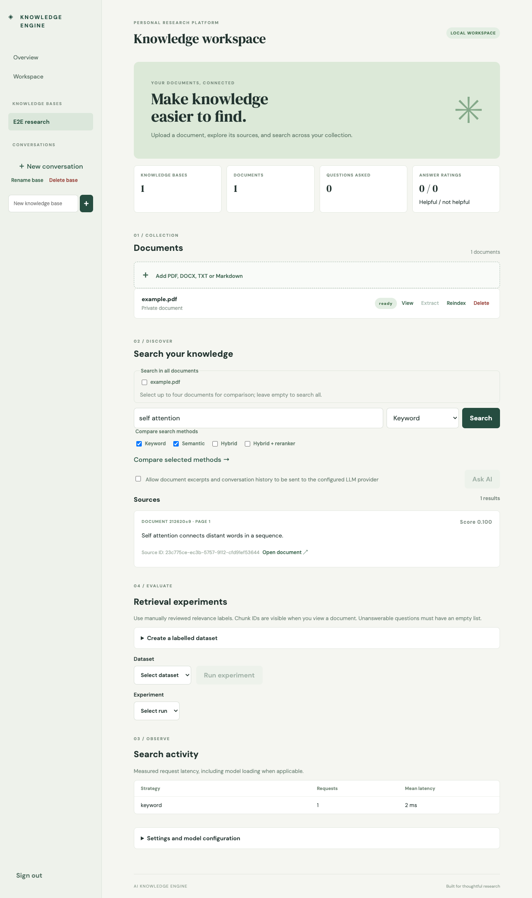

## Run in Google Colab

[Open the Colab notebook](https://colab.research.google.com/github/mivrichka1/ai-knowledge-engine/blob/main/AI_Knowledge_Engine_Colab.ipynb) and run its cells in order. Setup, storage, and model downloads use the temporary Colab runtime. Data is lost when the runtime is reset. Generation requires a separately configured provider.

# AI Knowledge Engine

An in-progress document search and question-answering application. It is not yet the complete production-style system described in the specification; see the limitations below.

## Implemented

- FastAPI authentication with Argon2 password hashes, short-lived JWT access tokens, hashed rotating refresh tokens and session logout.
- Owner-scoped knowledge bases, uploads and document/chunk access. Documents are processed by a separate PostgreSQL-backed worker using leased jobs and bounded retries.
- PDF (PyMuPDF), DOCX, UTF-8 TXT and Markdown extraction; scanned PDFs with no text layer are reported as requiring OCR. Chunking for actual indexing uses the embedding model tokenizer and overlap.
- CPU multilingual sentence embeddings stored in pgvector with model and revision metadata. PostgreSQL keyword search with an any-term fallback for plain queries, vector search, RRF hybrid retrieval and optional CrossEncoder reranking.
- OpenAI-compatible adapter, evidence-bounded context, citation ID validation, provisional SSE streaming, conversation history and structured extraction schema. Generation and extraction require an explicitly configured provider and explicit consent to send excerpts. Citation ID membership does **not** verify factual entailment.
- A local React interface for account access, collections, uploads, retrieval, document actions, conversation history, answer ratings and evaluation runs. The evaluation dashboard accepts manually labelled datasets, starts durable retrieval experiments, reports per-strategy metrics and exports JSON. Offline metric functions and a labelled-results evaluation command are also available.



The screenshot was captured from the running application during the Playwright test using its small test PDF; it is not an LLM-generated answer.

## Run locally

Docker and Docker Compose are required. Copy `.env.example` to `.env`, choose a strong JWT secret and a local PostgreSQL password composed of URL-safe characters, and optionally configure the LLM provider. Then:

```bash
docker compose up --build
```

Open `http://localhost:5173`; API docs are at `http://localhost:8000/docs`. The worker downloads public models on first use. `CHUNK_SIZE` and `CHUNK_OVERLAP` configure future indexing; changing them requires reindexing existing documents, and the size must fit the selected model context. Startup and indexing can take several minutes and require network access and disk space. Data and downloaded model caches are stored in Docker volumes. `docker compose down` stops the services without deleting volumes.

Without an LLM, upload and search remain available. An OpenAI-compatible provider can be configured with `LLM_BASE_URL`, `LLM_API_KEY`, and `LLM_MODEL`; local compatible servers may not require a key. Document excerpts and recent conversation history are sent to the configured provider only after the user opts in on the request. Parsing limits include 500 PDF pages and 2,000,000 extracted characters; the number of chunks per document is configurable. These limits do not provide process-level sandboxing. Do not expose the development configuration publicly.

## Tests and checks

From the repository root, create a Python 3.12 environment (`make setup` uses `python3.12`; override `PYTHON` if needed) and install `backend/requirements-dev.txt`. With a disposable PostgreSQL+pgvector database, set `TEST_POSTGRES_URL` and apply migrations with `DATABASE_URL` set, then:

```bash
cd backend
alembic upgrade head
python -m pytest tests ../tests -q
```

The PostgreSQL tests skip if `TEST_POSTGRES_URL` is absent. To run the optional model test with previously downloaded models, set `TEST_REAL_MODEL=1` and `HF_HOME` to their cache. The frontend builds with `cd frontend && npm ci && npm run build`. GitHub Actions configuration is provided but has not been observed running on GitHub.

## Evaluation

`python -m ake_backend.evaluation results.json --k 10` aggregates precision, recall, reciprocal rank, hit rate and binary nDCG for supplied manually labelled results. Unanswerable queries are counted separately. Partially labelled seed experiments of 40, 30 and 30 questions on three open papers are documented in `docs/evaluation.md`. They are too small for general quality claims. A 100-question anchor set exists, but independent review, complete relevance labels, broader coverage and comprehensive experiments remain unfinished; no general performance or coverage claims are made.

## Limitations

This is an incomplete development project, not a production deployment. Notable remaining work: distributed rate limiting and wider security hardening; additional document deletion, cancellation and reindexing hardening; more robust multi-turn retrieval and real-provider streaming verification; a representative, verified evaluation dataset; full API and frontend scenarios; a larger human-verified evaluation dataset; structured extraction quality evaluation; observability; robust request and job limits; broader automated tests, load testing and deployment validation. Deletion of a knowledge base containing documents is currently blocked. Chunking and PDF/DOCX extraction have limitations for complex layouts, scanned pages, formulas and tables. The reranker is English-oriented. Deleting a document removes its stored file and chunks and removes saved assistant messages that cite it; user-written messages may still contain information typed by the user. Reindexing preserves chunk IDs when text and offsets remain the same; changed chunks can invalidate older source links. The interface does not yet expose every backend capability. Real local 0.5B and 1.5B models were exercised on synthetic data and an open paper. One 1.5B response and its stream passed citation-ID checks; other RAG responses and extraction were rejected. This is not evidence of reliable answer quality or successful abstention. External LLM providers remain untested; see `docs/verification.md`. Prompt injection cannot be eliminated by instructions alone.

## Structure

- `backend/ake_backend`: API, processing, retrieval, model adapters and evaluation.
- `backend/alembic`: database migrations.
- `backend/tests`, `tests`: automated tests.
- `frontend`: React and Vite interface.
- `compose.yaml`: local PostgreSQL, migration, API, worker and frontend services.

## Optional demo seed

Obtain a permitted PDF such as [Attention Is All You Need](https://arxiv.org/abs/1706.03762) from its official source, start the application, and register an account in the interface. Then run `make seed-demo PDF=/absolute/path/to/paper.pdf`; the command prompts for the account password without echoing it. It creates a new demo knowledge base, uploads the PDF and waits for indexing. Every invocation creates a new base. This command has been tested with a deterministic HTTP transport, not yet against the latest Compose build.
